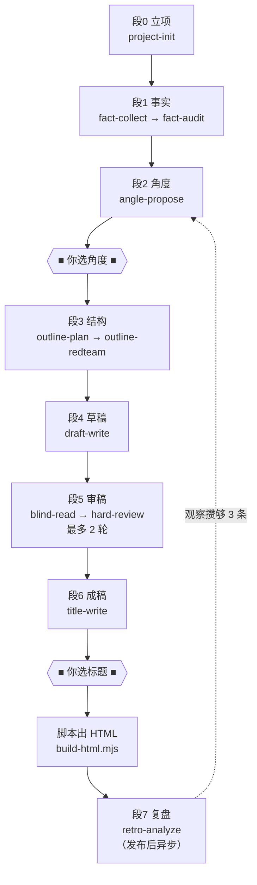

# 单篇内容执行手册

> **主 agent 唯一执行脚本**。用户给标题，说「按 `_工作流/00_执行手册.md` 执行」，主 agent 从立项跑到成稿，中途只在两个点停下来问你。
>
> agent 模板见 [`01_agents/`](01_agents/)；系列配置模板见 [`02_系列配置模板/`](02_系列配置模板/)；闸门脚本见 [`_scripts/check.mjs`](_scripts/check.mjs)。
> 旧版流程（27 个 subagent）已归档在 [`_archive/`](_archive/)，不再执行，仅供查阅。

---

## 用户启动区（只看这里）

复制下面两行，填标题，发给主 agent：

```text
文章标题：【在此填标题】
按 _工作流/00_执行手册.md 执行。
```

可选（不写则主 agent 自行推断）：

```text
系列：【系列文件夹名】
编号：【NN】
```

你会被打断两次，各花 1–2 分钟：

1. **选角度**：给你 3–5 个候选；每个说明新增价值、事实、可证伪点、文章发动机、独立收获、最强现场和首屏耗尽测试，你回一个编号。
2. **选标题**：给你 8 个候选 + 1 个推荐，你回一个编号或自己写。

除此之外不需要说「继续」。流程停止时你会收到 `人工介入.md`。

---

## 主 agent 执行契约

运行脚本前先检查 `node --version`，要求 **Node.js ≥ 18**。版本不足属于环境阻塞，不得伪造「闸门通过」，也不得绕过脚本继续。

收到「标题 + 按本手册执行」后，主 agent 必须：

1. **先完整读本文件**，再动任何项目文件。
2. **登记任务包**：系列路径、编号、项目绝对路径、**账号配置目录**（如 `_配置/头条号`）、**产物形态**（长文 / 图文组，读账号配置 `文风与格式.md` 判定）。
3. 建 `状态.json`，之后每完成一段就更新它。
4. **按段 0 → 段 6 顺序执行**。段内可并行的步骤见各段说明。
5. 每段结束**必须跑闸门脚本**，通过才进下一段：

   ```bash
   node _工作流/_scripts/check.mjs "<项目绝对路径>" --gate=<段号>
   ```

   脚本退出码非 0 = 未通过。**不得**以自己的判断代替脚本结论。
6. 每段结束向用户汇报一行：`段号 / 产物路径 / 闸门结论`，然后自动进入下一段。
7. 到停靠点（段 2、段 6 标题）**停下等用户回复**，不得自行决定。
8. **禁止**：凭记忆写事实；把其他文章正文喂给 subagent；跳过闸门脚本；用 agent 生成 HTML（HTML 由脚本产出）。

**缺信息只问一次**（如工作区有多个系列且用户没指定），问完继续跑。

### 停止条件

- 闸门脚本连续两次未通过且主 agent 无法定位原因
- 段 5 第 2 轮硬审后仍有必改项
- 事实闸门有 P0 无来源且补检索无果
- 用户明确打断

停止时写 `人工介入.md`：卡在哪段、什么问题、已试过什么、建议人工做什么。

---

## 总流程



单篇通常 **13 次 agent 调用**（结构反审或审稿需要返工时 14–16 次），加上发布后的复盘 1 次。新增的调用只用于阻止「事实正确、计划完成，但文章不值得读」的稿件过关。

---

## 目录与命名

```text
【NN】_【标题】/
  状态.json                    ← 断点续跑用，主 agent 维护
  00_立项.md
  01_事实包.md
  02_角度.md
  03_大纲.md
  04_草稿 v1.md                ← 每轮修订出新版本，旧版保留
  05_审阅/
    结构反审.md                 ← 大纲反方审查，不冒充普通读者
    盲读 v1.md                 ← vN 与草稿版本号严格一致
    硬审 v1.md
    未采纳.md                  ← 归档不做的建议，流程不再回头看
  06_成稿/
    标题.md
    终稿.md                    ← 唯一正文源
    终稿.html                  ← 脚本生成，长文系列 1 个
    预测.md                    ← 发布前登记，防事后合理化
  07_复盘/                     ← 发布后
    数据.md                    ← 你贴平台数据 + 评论原文
    复盘.md
  人工介入.md                   ← 仅异常时出现
```

**命名硬规则**：`盲读 vN.md`、`硬审 vN.md` 的 N **必须**等于当时被审的 `草稿 vN.md` 的 N。闸门脚本会校验配对，错了直接不通过。

只有一种 `vN`，就是草稿版本号。不存在第二套编号体系。

---

## 状态文件

`状态.json`：

```json
{
  "系列": "美国如何从工业国变成金融国",
  "编号": "10",
  "标题": "工作标题",
  "形态": "长文",
  "当前段": 4,
  "草稿版本": 1,
  "审稿轮次": 0,
  "待人工决策": null,
  "上次闸门": { "段": 3, "结果": "通过", "时间": "2026-08-14T20:00:00+08:00" }
}
```

`待人工决策` 取值：`null` / `"角度"` / `"标题"`。

中断后新开对话，主 agent 读这个文件即可续跑，不许靠猜。

---

## 段 0 · 立项

- **agent**：`project-init`
- **输出**：`00_立项.md`、目录骨架、`状态.json`
- **闸门**：`--gate=0`

`00_立项.md` 只有三样东西：核心问题、目标读者已经知道什么、**本文的赌注**。

赌注是一句话，格式固定：

```text
赌注：读者读完会明白【X】，而他现在以为是【Y】。
```

这一句是后面所有环节的唯一裁判标准。角度、大纲、硬审都回到它上面判断，不引入其他术语体系。

---

## 段 1 · 事实

- **agent**：`fact-collect` → `fact-audit`（串行，第二个必须是新 agent）
- **输出**：`01_事实包.md`（一份，不是三份）
- **闸门**：`--gate=1`
- **检索**：**MCP 优先**

`fact-collect` 检索建表，`fact-audit` 独立重查后在同一张表上补「核查」列。两个 agent 必须分开，`fact-audit` 不得读 `fact-collect` 的推理过程，只读表。

事实包是一张表，每行一条主张：

| 编号 | 主张 | 优先级 | 来源链接 | 原文引用 | 允许口径 | 禁止口径 | 核查 |
|---|---|---|---|---|---|---|---|
| F1 | … | P0 | https://… | 「…」 | … | … | 已核实 |

- **P0** = 文章论证的支点，塌了文章就不成立
- **P1** = 支撑细节
- **P2** = 背景color

**硬闸门**：每条 P0 必须有来源链接，或明确标 `待补`。`待补` 的 P0 不得进入大纲作为支点。这是全流程唯一一个绝对不能软化的闸门。

### 检索规则

适用 `fact-collect`、`fact-audit`、`title-write`。贴给 subagent 的标准句：

```text
优先使用已启用的 MCP 工具；MCP 不可用再用 WebSearch/WebFetch；
需要打开具体页面时用 cursor-ide-browser（navigate → snapshot）。
不得凭记忆补事实；搜不到就写「待补」。
```

---

## 段 2 · 角度 ■ 停靠点 1 ■

- **agent**：`angle-propose`
- **输出**：`02_角度.md`
- **闸门**：`--gate=2`

agent 出 3–5 个候选角度，每个写六行：

```text
读者已知：…
本文新增：…
需要的事实：F3、F7、F11（必须是已核实的 P0/P1）
如果错了，错在：…
工作标题：…
标题化难度：容易 / 一般 / 困难
```

工作标题在这里出，不等到段 6。依据是 `_反馈/已验证规律.md` L2：点击率决定平台放不放量，一个天生难起标题的角度，等成稿后才发现就只能硬凑了。

然后主 agent 把候选**原样贴给用户**，等用户回编号。用户选定后，主 agent 在 `02_角度.md` 顶部写入：

```text
已选角度：【编号】
放弃理由：【其余候选为什么不选，一句话一个】
```

`状态.json` 的 `待人工决策` 置为 `"角度"`，收到回复后清空。

**不得**由 agent 自行选定角度。角度好坏取决于用户对读者的了解，模型没有这个信息。

---

## 段 3 · 结构

- **agent**：`outline-plan`，然后 `outline-redteam`
- **输出**：`03_大纲.md`、`05_审阅/结构反审.md`
- **闸门**：`--gate=3`

大纲每节写明：要证明什么 / 用哪几条事实 / 新增什么不可替代的信息 / 用什么具体载体承载 / 删掉会少懂什么。另写 300–500 字的「读者路径」，只描述读者会经历的内容，不出现赌注、F 编号和施工术语。

**大纲不能用普通读者盲读。** 普通读者看到的是施工图和作者答案，只能复述作者意图；第 12 篇已经证明这是角色错配。`outline-redteam` 专门做六项反方测试：首屏耗尽、章节合并、新增信息、具体载体、读者利害、作者防守。

结论只有三种：

| 结论 | 下一步 |
|---|---|
| `可进草稿` | 进入段 4 |
| `修改大纲` | 主 agent 修改后必须重跑一次结构反审 |
| `退回角度` | 停靠并把证据交给用户，重新选角度；不得擅自换掉人工选择 |

结构反审最多 2 轮；第 2 轮仍不通过，写 `人工介入.md` 停止。

---

## 段 4 · 草稿

- **agent**：`draft-write`
- **输出**：`04_草稿 v1.md`
- **闸门**：`--gate=4`

只用事实包里已核实的行。保持大纲的论证链，但不得机械扩写：两节若落笔后明显重复，作者应压缩、合并或退回大纲，而不是为了完成节数拉长同一句话。草稿文件只放标题和正文，不再写「阶段 / 依据 / 说明」，避免盲读看到施工便签。

---

## 段 5 · 审稿（最多 2 轮）

- **agent**：每轮先 `blind-read`，落盘后再启动 `hard-review`（**严格串行**）
- **输出**：`05_审阅/盲读 vN.md`、`05_审阅/硬审 vN.md`
- **闸门**：`--gate=5`

每轮流程：

```text
1. 启动 `blind-read`。它只读标题和正文，先写自由阅读反应，再追加五行「读者判票」：主旨是否提前耗尽、跳读区数量、独立收获数、具体载体数、推荐动作。
2. **等盲读文件落盘**，再启动 `hard-review`。硬审先读稿 + 盲读锁定发布判断，再读事实包和配置核安全；不读立项、角度和大纲，避免把「完成作者计划」误当成「文章值得发布」。
3. hard-review 检查发布价值五闸（主旨寿命、信息推进、具体载体、读者利害、作者隐身）和安全两闸（事实、卫生）。
4. 根据根因给结论：`需改稿 / 退回大纲 / 退回角度 / 可冻结`。主 agent 必须同时处理盲读判票和硬审阻塞项，不能只修事实问题。
5. 只有七闸全通过后，润色建议才可归档到 `未采纳.md`。结构问题不得先降成建议再冻结。
6. 重跑第 2 轮；第 2 轮仍非 `可冻结` → 写 `人工介入.md` 停止。
```

**冻结条件**：发布价值五闸 + 安全两闸全部通过，硬审明确写 `结论：可冻结`。

以下盲读信号默认阻塞，硬审若想推翻必须引用正文反证：

- `主旨提前耗尽：是`
- `明显跳读区：2+`
- `独立收获数：0/1`
- `具体载体数：0/1`
- `推荐动作：无`

**说清楚不等于值得读，读得完不等于读得下去。** 第 12 篇盲读能准确复述主旨，却同时说后文反复确认、两处想跳、不会转发；旧硬审把这些归为「口味」后放行。新流程禁止这种降级。

**第 2 轮仍不通过** → 写 `人工介入.md`，停止。不跑第 3 轮。

`blind-read` 保持零上下文，是唯一不被上游材料剧透的审读，必须保留；但它只审读者真正会看到的草稿，不再盲读施工大纲。

冻结后主 agent 把最终草稿复制为 `06_成稿/终稿.md`。

---

## 段 6 · 成稿 ■ 停靠点 2 ■

- **agent**：`title-write`（1 次）
- **脚本**：`build-html.mjs`
- **输出**：`06_成稿/标题.md`、`06_成稿/终稿.html`
- **闸门**：`--gate=6`
- **检索**：**MCP 优先**（标题生态在 agent 内部做，不单独占一步）

流程：

1. `title-write` 出 8 个候选 + 1 个推荐 + 一句推荐理由 → `06_成稿/标题.md`
2. 主 agent 贴给用户，等回复；用户定后写入 `已选标题：…`
3. 跑格式闸门：`node _工作流/_scripts/check.mjs "<路径>" --gate=6`
4. 生成 HTML：

   ```bash
   node _工作流/_scripts/build-html.mjs "<项目绝对路径>"
   ```

**HTML 必须由脚本生成**。用 agent 转 HTML 既浪费又会悄悄改动正文；脚本转换天然保证正文一致，所以不需要「正文与终稿一致」这道人工闸门。

图文组系列（如 `一个人做产品`）用系列自己的 `_scripts/batch_build_entries.mjs`，产出每条图文一个 HTML，这是正常形态。

### 发布前登记预测

发 HTML 之前，主 agent 写两处。**两处都必须在发布前落盘，事后补填的作废。**

**一、篇级预测** → `06_成稿/预测.md`，三行：

```text
相对上一篇：更好 / 持平 / 更差
最担心哪一级漏斗：点击 / 完读 / 认同
理由：一句话
```

**二、标题预测** → 往 `_工作流/_反馈/标题预测.md` 的登记表追加一行：

从 `_反馈/表现台账.md` 取最近 5 篇点击率中位数作基准，记录选定标题满足和违反 `文风与格式.md` 6.2 的哪几条 T，预测档位（高 = ≥基准×1.5 / 中 / 低 = ≤基准×0.67），写一句指名依据哪条 T 的理由，并登记次选标题及它和选定标题差在哪条 T。

两处都不需要 agent 调用，主 agent 直接写，成本几乎为零。这是唯一能防事后合理化的手段——发完再看数据，人和模型都能编出一个自洽的解释。篇级预测管漏斗定位，标题预测管方法验证：满 10 条后统计每条 T 的命中率，低于 60% 的降级。

---

## 段 7 · 复盘（发布后，异步）

- **agent**：`retro-analyze`（1 次）
- **输入**：你贴的数据 → `07_复盘/数据.md`
- **输出**：`07_复盘/复盘.md`，观察条目追加到 `_工作流/_反馈/观察池.md`

不阻塞下一篇。数据什么时候有，什么时候跑。

### 你要贴什么

```text
展现量 / 阅读量 / 点击率 / 阅读时长 / 点赞 / 评论 / 收益
评论原文（能复制多少复制多少）
```

评论原文是这一段里最有价值的东西。读者用自己的话复述主旨的那些评论，就是真实世界的 blind-read，而且**不需要样本量**——三条评论就能告诉你赌注有没有送到。

### 三条铁律

1. **先排除时期混淆，再谈内容。** 同期整体塌方时，本篇的内容归因一律不成立。历史教训：同一篇文章隔月重发，展现量差 14 倍，标题正文一字未改。
2. **一律用期内百分位**，不用绝对值。账号在长大或在掉权重，跨期数字不可比。
3. **单篇复盘只产出观察，不改提示词。** 同向观察攒够 3 条（且跨主题、跨时期）才由 `pattern-mine` 提升格建议，人工确认后才动提示词，并记入 `_反馈/提示词变更日志.md`。

### 录数据

新数据追加到 `_工作流/_反馈/原始数据.tsv`，然后重算台账：

```bash
node _工作流/_scripts/ledger.mjs
```

### 挖规律

观察池里出现 ≥3 条同向观察时，跑一次 `pattern-mine`。它只提建议，升格和改提示词都要你点头。

**红线**：任何提示词变更不得放宽 `_配置/【账号】/读者与平台.md` 第六节的基调红线。打开率永远可以靠震惊体提升——不设这条，反馈闭环会稳定地把内容推向标题党，而且每一步都有数据支持。

---

## 系列形态

账号配置 `文风与格式.md` 里的 `形态` 字段决定两件事：

| 形态 | 正文结构 | HTML 产出 | 构建方式 |
|---|---|---|---|
| `长文` | 引言 + 4–7 节 + 结尾 | `06_成稿/终稿.html`，1 个 | `_工作流/_scripts/build-html.mjs` |
| `图文组` | 条目 × 卡片 | 每条图文 1 个 HTML | 系列自己的 `_scripts/` |

闸门脚本按形态分别判定 HTML 数量，不一刀切。

---

## 配置：两层

```text
_配置/
  头条号/
    读者与平台.md       ← 账号级，下辖所有系列共用
    文风与格式.md       ← 账号级，含形态字段和标题方法
  小红书号/
    读者与平台.md
    文风与格式.md

【系列】/_meta/
  系列配置.md           ← 系列级薄配置，顶部必须有「账号：X」
  已用论点.md           ← 跨篇去重
```

agent 读 3 份：账号级 2 份 + 系列级 1 份。

**为什么账号级。** 一个账号只有一批读者——平台推给你的人是被已发内容训练出来的，不会因为这篇换了题材就换一批。旧结构里每系列各写一份读者画像，四份互相漂移，等于四个系列对着四个想象中的人写作。读者、平台节奏、文风、格式、标题方法全部上提到账号级。

**系列级只留题材特有的东西**：母题词典、与源头著作的关系、题材边界、结构命题标准、角度评分的题材维度。开一个新系列只需要写这一份。

模板见 `_工作流/02_系列配置模板/`。校验：

```powershell
node _工作流/_scripts/check.mjs "<项目路径>" --config
```

脚本从 `系列配置.md` 的「账号：X」解析出账号，再去仓库根的 `_配置/X/` 找账号级两份。

---

## 系列去重

每篇完稿后，主 agent 往 `【系列】/_meta/已用论点.md` 追加三行：主论点、关键比喻、核心事实。

`angle-propose` **只读这一份摘要**，不读其他文章正文。这样既能发现"这个角度第 3 篇写过了"，又不会把旧文的措辞和结构带进新文。

---

## agent 清单

| 段 | agent | 模板 | 运行时 |
|---|---|---|---|
| 0 | 项目初始化 | `01_agents/01-project-init.md` | `.cursor/agents/project-init.md` |
| 1 | 事实检索 | `01_agents/02-fact-collect.md` | `.cursor/agents/fact-collect.md` |
| 1 | 事实复核 | `01_agents/03-fact-audit.md` | `.cursor/agents/fact-audit.md` |
| 2 | 角度候选 | `01_agents/04-angle-propose.md` | `.cursor/agents/angle-propose.md` |
| 3 | 大纲 | `01_agents/05-outline-plan.md` | `.cursor/agents/outline-plan.md` |
| 3 | 大纲反方审查 | `01_agents/06a-outline-redteam.md` | `.cursor/agents/outline-redteam.md` |
| 5 | 盲读 | `01_agents/06-blind-read.md` | `.cursor/agents/blind-read.md` |
| 4 | 草稿 | `01_agents/07-draft-write.md` | `.cursor/agents/draft-write.md` |
| 5 | 硬审 | `01_agents/08-hard-review.md` | `.cursor/agents/hard-review.md` |
| 6 | 标题 | `01_agents/09-title-write.md` | `.cursor/agents/title-write.md` |
| 7 | 单篇复盘 | `01_agents/10-retro-analyze.md` | `.cursor/agents/retro-analyze.md` |
| — | 跨篇挖规律 | `01_agents/11-pattern-mine.md` | `.cursor/agents/pattern-mine.md` |

**维护规则**：先改 `_工作流/01_agents/`，再整文件复制到 `.cursor/agents/` 并按上表改名。

### 启动 subagent 前的自检

1. 给了项目绝对路径？
2. 只列了本段必要的输入文件？
3. 写明禁止引用其他文章和主对话历史？
4. 写明输出文件路径？
5. 检索类的附了 MCP 优先说明？

---

## 完成汇报模板

```text
【NN】_【标题】— 完成

06_成稿/终稿.md（正文，N 字）
06_成稿/终稿.html
06_成稿/标题.md（已选：…）
01_事实包.md（P0 N 条，全部已核实）

审稿轮次：N 轮
闸门：段 0-6 全部通过
```
