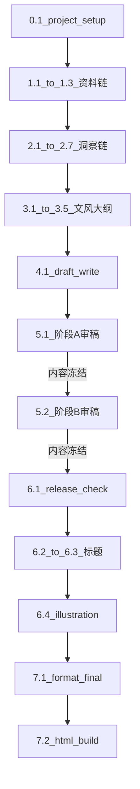

# 单篇文章从 0 到 HTML 成稿执行手册

> **主 agent 唯一执行脚本**。用户只需给标题并说「按本文件执行」，主 agent 从 project-setup 自动跑到 html-build。隔离规则见 [`00_隔离式临时subagent工作法.md`](00_隔离式临时subagent工作法.md)；subagent 模板见 [`01_标准subagent启动模板库.md`](01_标准subagent启动模板库.md)。

---

## 用户启动区（只看这里）

**复制下面两行，填标题，发给主 agent：**

```text
文章标题：【在此填标题】
按 _工作流/02_单篇文章从0到HTML成稿执行手册.md 执行，从 0 跑到 HTML 成稿。
```

**可选（不写则主 agent 自行推断）：**

```text
系列：【系列文件夹名，如 美国如何从工业国变成金融国】
文章编号：【NN，不填则读 系列/_meta/进度.md 或现有目录递增】
```

你**不需要**：逐步下指令、重复 00/01 规则、每步说「继续」——除非闸门失败或主 agent 输出 `人工介入报告.md`。

---

## 主 agent 执行契约（读本文件即生效）

收到「标题 + 按 02 执行」后，主 agent **必须**：

1. **先完整读取本文件**，再创建或修改任何项目文件。
2. **登记任务包**：系列路径、文章编号、项目文件夹 `【NN】_【标题】/`、当前文章绝对路径。
3. **从步骤 0.1 顺序执行到 7.2**，不得跳步（除非本文件写明「退回上游」或输出人工介入报告后停止）。
4. **每步**：检查上一步闸门 → 启动对应 subagent（Task `subagent_type` 或读 `.cursor/agents/`）→ 确认产物落盘 → 汇报 `步骤号 / 输出路径 / 闸门结论` → **自动进入下一步**。
5. **检索步骤**（1.1–1.3、2.1、6.2）：启动 subagent 时附带「MCP 优先」说明（见下文「MCP 检索规则」）。
6. **审稿**（5.1、5.2）：严格「三读 → 主编 → 改稿」；有必改或未闭环建议项则必须 draft-revise；直至主编结论 = `内容冻结，可进 release-check`。
7. **停止条件**：闸门不通过且无法在本步修复 / 审稿任一段第 5 轮仍有必改 / 用户明确打断。
8. **禁止**：凭记忆写资料或正文；引用其他文章正文；跳过 `06-release-check` 或 `06-format-final-check`。

**缺信息时只问一次**（如工作区有多个系列且用户未指定），问完继续自动跑，不要每步都问。

**subagent 调用约定**：

- 模板正文：`_工作流/03_subagents/【编号】-name.md`
- 运行时 agent：`.cursor/agents/name.md`（见 01 对照表）
- 启动时替换模板中所有【占位符】为当前任务包信息

---

## 前置条件

- 系列目录下 `_meta/_config/` 配置已就绪。
- `.cursor/agents/` 已从 `_工作流/03_subagents/` 同步。
- 主 agent 角色：项目经理；每阶段新开 subagent，不凭主对话记忆写正文。

---

## 总流程图



阶段 A 审 `04_草稿/草稿.md`（**草稿不分版本**，每轮修订都在同一份草稿上）；阶段 B 审 `06_修订与发布/修订稿 vN.md`（**修订稿从 v1 开始，每轮产出新版本**）；两阶段各自最多 5 轮。

### 文件命名与版本约定

| 文件类别 | 命名规则 | 含义 |
|---|---|---|
| 草稿 | `04_草稿/草稿.md`（无版本号） | 阶段 A 唯一被审对象；阶段 A 内可能改 1–4 轮，但永远是同一份 |
| 修订稿 | `06_修订与发布/修订稿 vN.md`（N=1..5） | 阶段 B 被审对象；每轮产出新版本，旧版本保留作对照 |
| 修订执行说明 | `06_修订与发布/修订执行说明 vN.md` | 与 `修订稿 vN.md` 同轮次；**纯流程记录**，不参与字数统计 |
| 阶段 A 审稿 | `05_审阅/{自由审读_草稿, 读者审读, 内容密度审读, 主编修改建议} vN.md`（vN 与草稿审稿轮次对齐） | 审 `草稿.md` |
| 阶段 B 审稿 | `05_审阅/{自由审读_修订稿 阶段B, 读者审读 阶段B, 内容密度审读 阶段B, 主编修改建议 阶段B} vN.md`（vN 与修订稿版本对齐） | 审 `修订稿 vN.md` |
| 大纲 | `03_文风与大纲/大纲.md`（首次），`大纲 v2.md` / `v3.md`（按需） | 首次为 v1，按审阅修订另存为 v2+ |

**注意区分两种「vN」**：

- 阶段 A 审稿文件里的 `vN`：指阶段 A 的第 N 轮审稿（审同一份草稿）
- `修订稿 vN.md` 里的 `vN`：指修订稿的版本号，每轮出新版本

**例**：阶段 A 第 2 轮主编结论「进入下一轮修订」→ 阶段 A 第 3 轮继续审 `草稿.md`；若阶段 A 第 3 轮主编结论「内容冻结」→ 进入阶段 B，**首次产出** `修订稿 v1.md`，然后阶段 B 第 1 轮审 `修订稿 v1.md`（文件名为「主编修改建议 阶段B v1.md」）。

---

## MCP 检索规则

**适用步骤**：1.1、1.2、1.3（段 1 全程）、2.1、6.2。

| 步骤 | 检索目的 |
|---|---|
| 1.1 source-research | 原始资料、数据口径、时间线 |
| 1.2 evidence-ledger | 按来源建账；来源不足须补搜 |
| 1.3 fact-check | P0/P1 二次核对、冲突裁决 |
| 2.1 ecosystem-scan | 同题写法、常见角度、避坑 |
| 6.2 title-ecosystem | 标题生态、竞品标题分布 |

**优先级**：

1. **已启用 MCP 工具**（优先于模型记忆与 WebSearch）
2. **WebSearch / WebFetch**（MCP 不可用或未覆盖时）
3. **禁止**：无来源断言；搜不到写「待补资料」；段 1 禁止跳过检索把 P0 标为「已核实」

**贴给 subagent 的标准句**：

```text
若本任务需要检索外部信息，优先使用已启用的 MCP 工具；
MCP 不可用再使用 WebSearch/WebFetch；不得凭记忆补事实。
需打开具体页面时，用 cursor-ide-browser（navigate → snapshot）。
```

### 段 1 检索 checklist（1.3 完成后主 agent 自检）

- [ ] 1.1 已完成 MCP/网页检索，非凭记忆
- [ ] 每条 P0 主张有来源或标「待补资料」
- [ ] 1.3 对关键数字/日期/人物关系做过独立核对
- [ ] `资料.md`、`证据台账.md`、`事实核查清单.md` 口径一致，无未标注冲突

---

## 最终交付物

一篇完成时至少存在：

- `06_修订与发布/修订稿 vN.md`（最后一版**纯正文**源，不含修订执行说明）
- `06_修订与发布/修订执行说明 vN.md`（与最后一版修订稿同轮次的流程记录）
- `06_修订与发布/发布检查.md`（内容闭环通过）
- `07_传播终审与标题/标题方案.md`（已定标题）
- `08_插图/插图方案.md` + `prompts.json`
- `06_修订与发布/成稿终审.md`（结论：通过，可进 html-build）
- `09_终稿/【文章编号】_终稿.html`（唯一 HTML）

---

## 步骤脚本（0.1 → 7.2）

以下每步格式统一。主 agent **按编号顺序执行**。

---

#### 步骤 0.1 项目初始化

- **subagent**：`00-project-setup`（`.cursor/agents/project-setup.md`）
- **输入**：用户标题；系列名；文章编号（或待推断）；系列 `_meta/` 与 `_config/` 路径
- **输出**：`【NN】_【标题】/README.md`、`总计划.md`、`00_目录结构.md` 及完整目录树
- **操作**：推断或确认编号；创建项目文件夹；启动 project-setup；占位符填齐
- **闸门**：目录结构完整，README/总计划/00_目录结构 已落盘
- **下一步**：1.1
- **检索**：无

---

#### 步骤 1.1 资料研究

- **subagent**：`01-source-research`（`.cursor/agents/source-research.md`）
- **输入**：`README.md`、`总计划.md`；系列配置（如需）
- **输出**：`01_资料/资料.md`
- **操作**：启动 subagent；**附带 MCP 优先说明**；确认来源可追溯
- **闸门**：`资料.md` 已落盘；缺口已标「待补资料」，非空白编造
- **下一步**：1.2
- **检索**：**MCP 优先**

---

#### 步骤 1.2 证据台账

- **subagent**：`01-evidence-ledger`（`.cursor/agents/evidence-ledger.md`）
- **输入**：`01_资料/资料.md`
- **输出**：`01_资料/证据台账.md`
- **操作**：逐条建账；争议/弱来源标注；来源不足则回 1.1 补搜或当场 MCP
- **闸门**：台账与资料可追溯对应
- **下一步**：1.3
- **检索**：**MCP 优先**（补来源时）

---

#### 步骤 1.3 事实核查

- **subagent**：`01-fact-check`（`.cursor/agents/fact-check.md`）
- **输入**：`资料.md`、`证据台账.md`
- **输出**：`01_资料/事实核查清单.md`
- **操作**：P0/P1 二次检索核对；完成后执行「段 1 检索 checklist」
- **闸门**：**P0 无未清项**方可进 2.1；否则停止或回 1.1 补资料
- **下一步**：2.1（P0 通过）/ 停止（P0 未清）
- **检索**：**MCP 优先**

---

#### 步骤 2.1 外部内容生态

- **subagent**：`02-ecosystem-scan`（`.cursor/agents/ecosystem-scan.md`）
- **输入**：`README.md`、`总计划.md`；检索结果（MCP）
- **输出**：`02_洞察及主题/外部内容搜索.md`
- **操作**：附带 MCP 优先说明
- **闸门**：文件已落盘
- **下一步**：2.2
- **检索**：**MCP 优先**

---

#### 步骤 2.2 洞察初选

- **subagent**：`02-insight-select`（`.cursor/agents/insight-select.md`）
- **输入**：`资料.md`、`证据台账.md`、`外部内容搜索.md`
- **输出**：`02_洞察及主题/洞察及主题初选.md`
- **操作**：启动 subagent
- **闸门**：文件已落盘
- **下一步**：2.3
- **检索**：无

---

#### 步骤 2.3 传播学审查卡

- **subagent**：`02-communication-criteria`（`.cursor/agents/communication-criteria.md`）
- **输入**：系列传播配置、`README.md`、`总计划.md`、`事实核查清单.md`
- **输出**：`02_洞察及主题/传播学审查卡.md`
- **闸门**：文件已落盘
- **下一步**：2.4
- **检索**：无

---

#### 步骤 2.4 传播学分析

- **subagent**：`02-communication-analyze`（`.cursor/agents/communication-analyze.md`）
- **输入**：传播学审查卡、外部内容搜索、洞察及主题初选、事实核查清单
- **输出**：`02_洞察及主题/传播学分析卡.md`
- **闸门**：文件已落盘
- **下一步**：2.5
- **检索**：无

---

#### 步骤 2.5 结构命题审查卡

- **subagent**：`02-structure-criteria`（`.cursor/agents/structure-criteria.md`）
- **输入**：系列结构命题配置、`README.md`、`总计划.md`、`事实核查清单.md`
- **输出**：`02_洞察及主题/结构命题审查卡.md`
- **闸门**：文件已落盘
- **下一步**：2.6
- **检索**：无

---

#### 步骤 2.6 结构命题分析

- **subagent**：`02-structure-analyze`（`.cursor/agents/structure-analyze.md`）
- **输入**：结构命题审查卡、洞察及主题初选、事实核查清单
- **输出**：`02_洞察及主题/结构命题分析卡.md`
- **闸门**：文件已落盘
- **下一步**：2.7
- **检索**：无

---

#### 步骤 2.7 方向把控

- **subagent**：`02-direction-decide`（`.cursor/agents/direction-decide.md`）
- **输入**：传播学分析卡、结构命题分析卡、事实核查清单、README、总计划、系列配置
- **输出**：`02_洞察及主题/方向把控.md`
- **闸门**：结论**允许进入文风卡/大纲**；若「退回洞察/补事实」则停止并退回对应步骤
- **下一步**：3.1（通过）/ 退回 2.2 或 1.x（按方向把控结论）
- **检索**：无

---

#### 步骤 3.1 文风卡

- **subagent**：`03-style-guide`（`.cursor/agents/style-guide.md`）
- **输入**：方向把控、传播学/结构分析卡、事实核查清单、系列文风配置
- **输出**：`03_文风与大纲/文风卡.md`
- **闸门**：文件已落盘
- **下一步**：3.2
- **检索**：无

---

#### 步骤 3.2 读者审稿卡

- **subagent**：`03-reader-criteria`（`.cursor/agents/reader-criteria.md`）
- **输入**：方向把控、文风卡、读者画像、平台配置、事实核查清单
- **输出**：`03_文风与大纲/读者审稿卡.md`
- **闸门**：文件已落盘
- **下一步**：3.3
- **检索**：无

---

#### 步骤 3.3 大纲

- **subagent**：`03-outline-plan`（`.cursor/agents/outline-plan.md`）
- **输入**：方向把控、文风卡、文章结构与格式配置、事实核查清单、传播/结构分析卡
- **输出**：`03_文风与大纲/大纲.md`
- **闸门**：文件已落盘
- **下一步**：3.4
- **检索**：无

---

#### 步骤 3.4 自由审读（大纲）

- **subagent**：`05-free-review`（`.cursor/agents/free-review.md`）
- **输入**：**仅** `03_文风与大纲/大纲.md` 正文（零上下文）
- **输出**：`03_文风与大纲/自由审读_大纲.md`
- **闸门**：文件已落盘
- **下一步**：3.5
- **检索**：无

---

#### 步骤 3.5 大纲审阅

- **subagent**：`03-outline-review`（`.cursor/agents/outline-review.md`）
- **输入**：大纲、自由审读_大纲、方向把控、文风卡、文章结构与格式配置、事实核查清单
- **输出**：`03_文风与大纲/大纲审阅.md`
- **闸门**：**无必改项**方可进 4.1；有必改则启动 `outline-plan` **修订模式** → 另存 `大纲 v2.md`（**保留** v1 `大纲.md`，不得覆盖）→ **重跑 3.4→3.5**（审阅对象 = 最新版大纲）；「退回上游」则停止
- **下一步**：4.1（通过，施工图 = 最新版大纲）/ 3.3–3.5 循环 / 停止
- **检索**：无

---

#### 步骤 4.1 首版草稿

- **subagent**：`04-draft-write`（`.cursor/agents/draft-write.md`）
- **输入**：大纲（或最新 `大纲 vN.md`）、大纲审阅、文风卡、读者审稿卡、事实核查清单、资料、证据台账、方向把控
- **输出**：`04_草稿/草稿.md`
- **闸门**：草稿已落盘
- **下一步**：5.1
- **检索**：无

---

#### 步骤 5.1 阶段 A 审稿循环

- **对象**：`04_草稿/草稿.md`（**无版本号**，阶段 A 内多轮审同一份草稿）
- **轮次**：阶段 A v1..v5

**每轮顺序（硬规则，不得打乱）**：

```text
A1. free-review     → 05_审阅/自由审读_草稿.md（阶段 A 内同一份，修订后可更新）
A2. reader-review  → 05_审阅/读者审读 vN.md（vN = 阶段 A 第 N 轮）
A3. density-edit   → 05_审阅/内容密度审读 vN.md（vN = 阶段 A 第 N 轮）
    （A1–A3 三读全部落盘后才可以 A4）
A4. editor-review  → 05_审阅/主编修改建议 vN.md（vN = 阶段 A 第 N 轮）
A5. 读主编结论：
    - 「进入下一轮修订」→ 主 agent 直接修订 `草稿.md`，**不另存**；进入 vN+1 轮
    - 「大修后复审」→ 改草稿后重跑 A1–A4
    - 「退回上游」→ 停止，退回 3.x 或 2.7 或 1.x
    - 「内容冻结，可进 release-check」→ 结束 5.1，进入 5.2（**首次产出** `修订稿 v1.md`）
```

- **subagent**：`free-review` / `reader-review` / `density-edit` / `editor-review`
- **主编结论**：有必改或未闭环建议项 → **不得**内容冻结；成稿卫生 H1 命中 → 必改
- **上限**：第 5 轮仍有必改 → 写 `06_修订与发布/人工介入报告.md`，**停止**
- **下一步**：5.2（阶段 A 内容冻结后；**首次**产出 `修订稿 v1.md` 进入阶段 B）
- **文件命名要点**：审稿文件名 `vN` 与「阶段 A 第 N 轮」对齐，**不与修订稿版本号联动**

---

#### 步骤 5.2 阶段 B 审稿循环

- **对象**：`06_修订与发布/修订稿 vN.md`（**每轮出新版本**）
- **轮次**：阶段 B v1..v5（**与修订稿版本号对齐**——B 第 1 轮审 `修订稿 v1.md`，B 第 2 轮审 `修订稿 v2.md`）

**每轮顺序**：

```text
B1. free-review     → 05_审阅/自由审读_修订稿 阶段B vN.md
B2. reader-review  → 05_审阅/读者审读 阶段B vN.md
B3. density-edit   → 05_审阅/内容密度审读 阶段B vN.md
    （B1–B3 全部落盘后再 B4）
B4. editor-review  → 05_审阅/主编修改建议 阶段B vN.md
B5. 读主编结论：
    - 「进入下一轮修订」→ draft-revise 产出 `修订稿 v(N+1).md` + `修订执行说明 v(N+1).md`，轮次+1，重跑 B1–B4
    - 「大修后复审」→ 改 `修订稿 vN.md` 后重跑 B1–B4（同版本内）
    - 「退回上游」→ 停止
    - 「内容冻结，可进 release-check」→ 结束 5.2，进入 6.1
```

- **subagent**：`free-review` / `reader-review` / `density-edit` / `editor-review` / `draft-revise`
- **改稿优先级**（draft-revise 内）：H1 成稿卫生 → 主编/读者必改 → 本版必处理建议项 T*
- **上限**：阶段 B 第 5 轮仍有必改 → `人工介入报告.md`，**停止**
- **下一步**：6.1（内容冻结后）
- **文件命名要点**：阶段 B 审稿文件名 `阶段B vN` 中 `vN` **必须**与被审对象 `修订稿 vN.md` 的版本号一致；二者强绑定

---

#### 步骤 6.1 发布检查（内容闭环）

- **subagent**：`06-release-check`（`.cursor/agents/release-check.md`）
- **输入**：最后一版 `修订稿 vN.md`；最后一轮三读+主编；证据台账；事实核查清单
- **前置**：主编最新结论 = `内容冻结，可进 release-check`
- **输出**：`06_修订与发布/发布检查.md`
- **闸门**：发布检查**通过**才进 6.2；不通过则回到 5.2 或人工介入
- **下一步**：6.2（通过）
- **检索**：无

---

#### 步骤 6.2 标题生态

- **subagent**：`07-title-ecosystem`（`.cursor/agents/title-ecosystem.md`）
- **输入**：README、总计划、方向把控、传播学分析卡、标题方法论配置
- **输出**：`07_传播终审与标题/标题生态搜索.md`
- **操作**：附带 MCP 优先说明
- **闸门**：文件已落盘
- **下一步**：6.3
- **检索**：**MCP 优先**

---

#### 步骤 6.3 标题方案

- **subagent**：`07-title-write`（`.cursor/agents/title-write.md`）
- **输入**：标题生态搜索、发布检查、修订稿、方向把控、文风卡、事实核查清单
- **输出**：`07_传播终审与标题/标题方案.md`（含**已选定**发布标题）
- **闸门**：已定标题
- **下一步**：6.4
- **检索**：无

---

#### 步骤 6.4 插图方案

- **subagent**：`08-illustration-plan`（`.cursor/agents/illustration-plan.md`）
- **输入**：修订稿、标题方案、文风卡、方向把控、发布检查
- **输出**：`08_插图/插图方案.md`、`08_插图/prompts.json`
- **闸门**：文件已落盘
- **下一步**：7.1
- **检索**：无

---

#### 步骤 7.1 成稿终审（格式）

- **subagent**：`06-format-final-check`（`.cursor/agents/format-final-check.md`）
- **输入**：最终修订稿、标题方案、插图方案、发布检查
- **输出**：`06_修订与发布/成稿终审.md`
- **闸门**：结论 = **`通过，可进 html-build`**；否则退回改格式/卫生，**不得**进 7.2
- **下一步**：7.2（通过）
- **检索**：无

---

#### 步骤 7.2 HTML 终稿

- **subagent**：`09-html-build`（`.cursor/agents/html-build.md`）
- **输入**：最终修订稿、标题方案、成稿终审（已通过）、插图路径
- **输出**：`09_终稿/【文章编号】_终稿.html`（**唯一** HTML 文件）
- **前置**：`成稿终审.md` 已通过；禁止跳过 7.1
- **闸门**：HTML 已生成；标题与标题方案一致；正文与修订稿一致（仅格式转换）
- **下一步**：**流程结束**——向用户汇报交付物清单
- **检索**：无

---

## 主 agent 每步启动 checklist（内部用）

启动任何 subagent 前：

1. 当前文章项目绝对路径
2. 只列必要输入文件
3. 禁止引用其他文章 / 主对话历史
4. 明确输出文件路径
5. 明确本阶段不做下一阶段工作
6. 检索步骤附带 MCP 优先说明

---

## 参考样例

- 系列第 09 篇目录结构可作参考，**不得**复制其正文到其他篇。
- 本流程已含：density-edit 三读、主编成稿卫生 H1、建议项未闭环禁止冻结、release-check + format-final-check 双终审。

---

## 流程结束汇报模板

```text
【文章】NN_标题 — 已完成 0→HTML

交付物：
- 06_修订与发布/修订稿 vN.md（纯正文）
- 06_修订与发布/修订执行说明 vN.md
- 06_修订与发布/发布检查.md
- 07_传播终审与标题/标题方案.md（主推标题：…）
- 08_插图/插图方案.md + prompts.json
- 06_修订与发布/成稿终审.md
- 09_终稿/NN_终稿.html

阶段 B 审稿轮次：vN
停止原因：正常完成 / 人工介入（见 人工介入报告.md）
```
